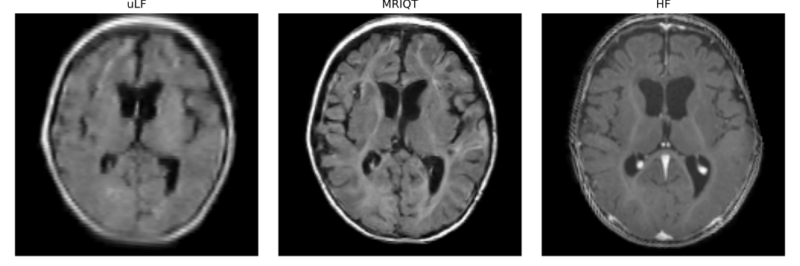
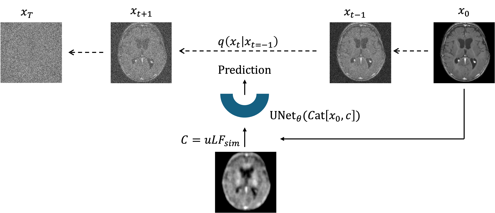
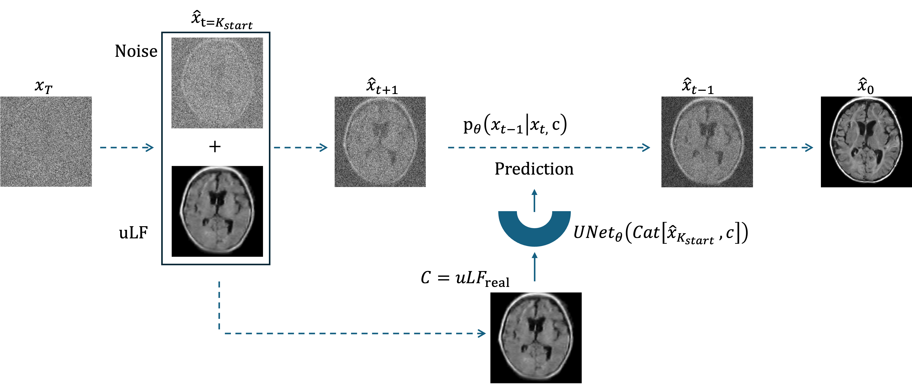
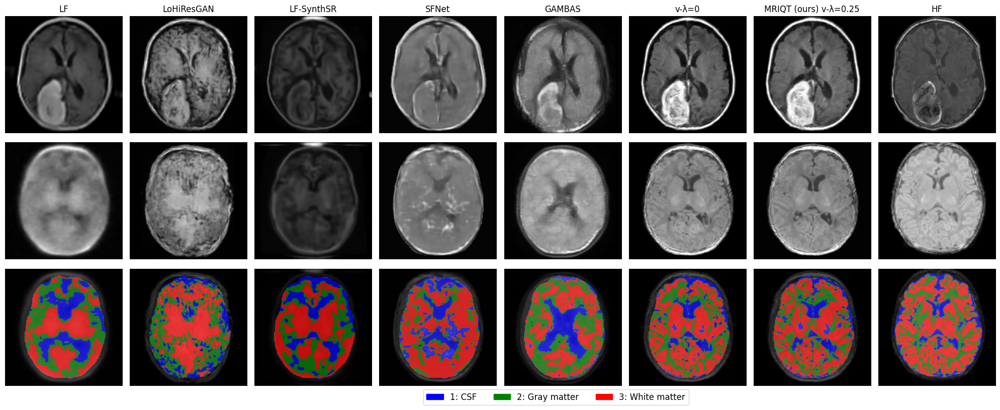
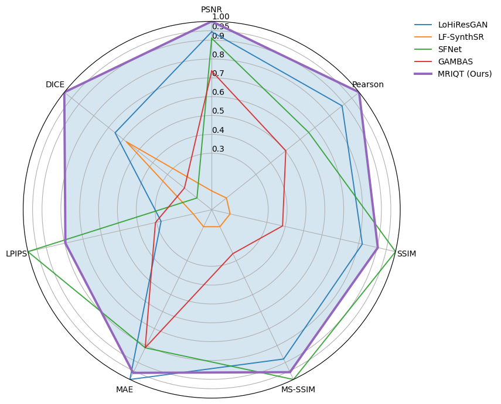

**Slide to compare** the portable ultra-low-field scan (uLF, right) with the MRIQT enhancement (left). Use the buttons to switch between two patients.


Neonatal brain MRI from the University Hospital Bonn cohort. Ethical approval: Ethics Committee of the University of Bonn (Nr. 167/22).


[arXiv](https://arxiv.org/abs/2511.13232) · [PDF](https://arxiv.org/pdf/2511.13232.pdf) · [Code](https://github.com/albarqounilab/MRIQT) · Accepted at [IEEE ISBI 2026](https://biomedicalimaging.org/2026/), London

### Why it matters

Infants change fast in the first weeks of life: their brains differ from adult brains in both anatomy and tissue contrast. In **neonatal intensive care units**, many infants have neurological conditions that need repeated MRI, yet standard **high-field MRI** means disconnecting them from life support and moving them to a scanner room — slow, often requiring sedation and exposure to loud noise.

**Portable ultra-low-field MRI** (0.064 T) brings the scanner to the bedside, but with low signal-to-noise and reduced diagnostic quality. **MRIQT** closes that gap: it performs **3D image-quality transfer (uLF → high-field)** with a conditional diffusion model guided by **physics-aware k-space simulation** and an **anatomy-preserving 3D perceptual objective**. The cohort comprises neonates with an average age of two months and nine clinically relevant neurological pathologies, often occurring together.

### How it works

- **Physics-aware degradation:** realistic ultra-low-field scans are simulated from high-field ones in k-space.
- **3D conditional diffusion:** the model enhances the scan while preserving anatomy.
- **Guidance and an SNR-weighted 3D perceptual loss** reduce artefacts and hallucinations.

**Training** — MRIQT learns from physics-based uLF simulations to reconstruct anatomically faithful images from noisy inputs:

**Inference** — given a real uLF scan, MRIQT iteratively denoises a noisy initialisation while conditioning on the uLF measurement:

### Results

Compared with competing methods on PSNR, LPIPS, MAE, MS-SSIM, SSIM and Pearson correlation:

