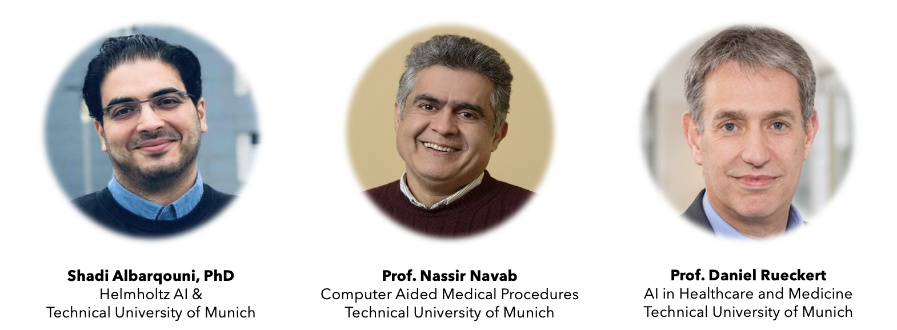

Organizers: [Dr. Shadi Albarqouni](../../#about), [Helmholtz AI](https://www.helmholtz.ai/) and [TU Munich](https://www.in.tum.de/en/cover-page/), [Prof. Nassir Navab](http://campar.in.tum.de/Main/NassirNavab), Chair for [Computer Aided Medical Procedures](http://campar.in.tum.de/WebHome), and [Prof. Daniel Rueckert](http://aim-lab.io/author/daniel-ruckert/), Chair for [AI in Medicine](http://aim-lab.io/),  [TU Munich](https://www.in.tum.de/en/cover-page/)

Time: Fridays, 10:00 - 12:00 

#### Announcements
- 14-07-2021: The deadline of the blog post is extended to Thursday, 22.07.2021.
- 14-04-2021: Papers are assigned. Please have a look at the table below. 
- 08-04-2021: Please send 3-4 preferences from different topics (Data Heterogeneity, Robustness, ...etc.) to [Cosmin Bercea](../../authors/cosmin-bercea/) by 13th April 2021. 
- 29-01-2021: Preliminary meeting is moved to Friday, 05.02.2021  (11:00-11:30). Please register in advance for this meeting through this [link](https://tum-conf.zoom.us/meeting/register/u5ApcuihqjIoGNe7lbY6r6O-vGtHHagGK2nw). After the registration, you will receive a confirmation email with the dial-up information. 
- 19-01-2021: Preliminary meeting:  <s>Monday, 01.02.2021  (11:00-11:30)</s> via Zoom
- 19-01-2021: Contact information: if you have any questions about this seminar, please feel free to contact [Dr. Shadi Albarqouni](mailto:shadi.albarqouni@tum.de)
- 19-01-2021: The website is up!

### Introduction

Following the great success of our on-going seminar on Deep Learning for Medical Applications, we would like to discuss advanced topics that are quite relevant to Federated Learning which becomes an interesting and hot research direction in the community. In simple words, Federated Learning enables training models at the client-side while preserving their privacy, and aggregates the knowledge from the nodes to learn a global model. The interesting part here that the data are kept private and not transmitted to any other nodes. Instead, the characteristics (e.g. parameters) of the global model are shared with the clients, and once the training is done locally, the characteristics are sent back to the global one for aggregation. This learning paradigm has been received quite nicely in the community, in particular, for sensitive domains, e.g. Healthcare. To push this momentum, we proposed, together with our academia and industry partners, a workshop on [Federated, Collaborative, and Distributed Learning](https://dcl-workshop.github.io/) in the [International Conference on Medical Image Computing and Computer-Aided Intervention (MICCAI)](https://miccai2020.org/en/) to attract significant contributions attacking the challenges in Medical Imaging and Healthcare. In this seminar, we will be discussing the relevant papers on Federated Learning with an emphasis on the papers tackling the common challenges in Medical Imaging, e.g. data heterogeneity, domain shift, and non-iid distributed data. 

### Registration
   * Interested students should attend the preliminary meeting to enlist in the course.
   * Students can only register through [TUM Matching Platform](https://matching.in.tum.de/) themselves if the maximum number of participants hasn't been reached (please pay attention to the [Deadlines](http://docmatching.in.tum.de/index.php/schedule)).
   * A maximum number of participants: 12.

### Requirements
In this Master Seminar, each student is asked to send three preferences from the list, then he will be assigned one paper. In order to successfully complete the seminar, participants have to fulfill these requirements:

   * **Presentation**: The selected paper is presented to the other participants.
   * **Blog Post**: A blog post of 1000-1500 words excluding references should be submitted before the deadline.
   * **Attendance**: Participants have to participate actively in all seminar sessions.

The students are required to attend each seminar presentation which will be held during this course. Each presentation is followed by a discussion and everyone is encouraged to actively participate. The blog post must include all references used and must be written *completely in your own words*. Copy and paste will not be tolerated. Both the blog post and presentation have to be written in *English*. 

**Submission Deadline**:  You have to submit the presentation *two weeks* right after your presentation session. Please push your slides to the respective folder, i.e., SS2021, at this [repository](https://gitlab.lrz.de/Albarqouni_BMC/flh2020.git), and create your blog at the Wiki section under Blogs. The deadline of the blog post is extended to Thursday, 22.07.2021.

**Guidelines:**
I could not find better than this [guidelines](https://ocw.mit.edu/courses/brain-and-cognitive-sciences/9-916-the-neural-basis-of-visual-object-recognition-in-monkeys-and-humans-spring-2005/assignments/how_to_pres_pap.pdf) to prepare for your presentation. The only difference is that you need to plan for 30 minutes for 1-4, and 10 minutes  for 5). Nevertheless, I have prepared a few slides acting as a [guidelines](../../slides/pres) for your presentation and blog posts. 

### Schedule

| *Date (tentative)* | *Session: Topic* | *Speakers / Presenters* | *Slides* |
| --- | --- | --- | --- |
| 05.02.2021 (11:00 AM) | Preliminary Meeting | Shadi | [Slides](https://albarqouni.github.io/slides/federated/#/) |
| Online | Paper Assignment | Shadi/Cosmin |  |
| 16.04.2021 |  Guidelines | Shadi |  |
| 30.04.2021 | Data Heterogeneity I | Buess, Yirik |  |
| 14.05.2021 | Data Heterogeneity II | Buchberger, Flecken |  |
| 28.05.2021 | -- | -- |  |
| 11.06.2021 | Robustness | Stampfl, Mostafa |  |
| 25.06.2021 | **Federated Learning in Healthcare: from Theory to Practice** | Dr. [Marco Lorenzi](https://marcolorenzi.github.io/), Inria, France |  |
| 09.07.2021 | Uncertainty and Interpretability | Yu, Feil |  |

### List of Topics and Papers

| *Topic* | *No* | *Title* | *Conference/Journal* | *Tutor* | *Student (Last name)* | *Link* |
| --- | --- | --- | --- | --- | --- | --- |
| Data Heterogeneity |  1  |  FedDG: Federated Domain Generalization on Medical Image Segmentation via Episodic Learning in Continuous Frequency Space | CVPR 2021 |         |                       | [PDF](https://arxiv.org/pdf/2103.06030.pdf) |
|         |  2 |   Personalized Federated Learning using Hypernetworks      |      arxiv 2021 |   | Buess  |  [PDF](https://arxiv.org/pdf/2103.04628.pdf)  |
|         |  3 | Adaptive Federated Optimization | ICLR 2021 |    |     |  [PDF](https://arxiv.org/pdf/2003.00295.pdf)      |
|         |  4 |  FedMix: Approximation of Mixup Under Mean Augmented Federated Learning  |  ICLR 2021  |   |  | [PDF](https://openreview.net/pdf?id=Ogga20D2HO-)        |
|         |  5 | HeteroFL: Computation and Communication Efficient Federated Learning for Heterogeneous Clients |   ICLR 2021  |   | Yirik | [PDF](https://openreview.net/pdf?id=TNkPBBYFkXg)       |
|         |  6 | Personalized Federated Learning with First Order Model Optimization    | ICLR 2021        |   |  Buchgberger |   [PDF](https://arxiv.org/pdf/2012.08565v3.pdf)   |
|         |  7 | Federated Learning Based on Dynamic Regulariation    |  ICLR 2021  |   |  | [PDF](https://openreview.net/pdf?id=B7v4QMR6Z9w)        |
|         |  8  | Tackling the Objective Inconsistency Problem in Heterogenous Federated Optimization   | NeurIPS 2020  |   |  |  [PDF](https://arxiv.org/pdf/2007.07481.pdf)  |
|         |  9 |   Ensemble Distillation for Robust Model Fusion in Federated Learning  | NeurIPS 2020         |   |  |   [PDF](https://arxiv.org/pdf/2006.07242.pdf)  |
|         | 10 |   Salvaging Federated Learning by Local Adaptation      |  arxiv  2020       |   | Flecken | [PDF](https://arxiv.org/pdf/2002.04758.pdf)       |
|         | 11  |  FedAwS: Federated Learning with Only Positive Labels      |   ICML 2020      |   |  |  [PDF](http://www.sanjivk.com/FedPositive_ICML20.pdf)      |
|  |  |  |  |  |  |  |
| Robustness | 12  | Provable Defense against Privacy Leakage in Federated Learning from Representation Perspective  |   CVPR 2021      |   |  |   [PDF](https://arxiv.org/pdf/2012.06043.pdf)    |
|         |  13 | Untargeted Poisoning Attack Detection in Federated Learning via Behaviour Attestation        |   arxiv 2021      |   |  | [PDF](https://arxiv.org/pdf/2101.10904.pdf)       |
|         | 14  | Privacy and Robustness in Federated Learning: Attacks and Defenses  |  arxiv 2020       |   | Stampfl |  [PDF](https://arxiv.org/pdf/2012.06337.pdf)      |
|         | 15  | How to backdoor federated learning   | PMLR 2020        |   | Mostafa |  [PDF](https://arxiv.org/pdf/1807.00459.pdf)      |
|         | 16  |   DBA: Distributed Backdoor Attacks against Federated Learning      | ICLR 2020        |   |  | [PDF](https://openreview.net/pdf/61dc789b9f12be96506a23ddb7670ac132a51d6d.pdf)       |
|  |  |  |  |  |  |  |
| Privacy and Security | 17  |   Federated f-Differential Privacy      |    PMLR 2021     |   |  | [PDF](http://proceedings.mlr.press/v130/zheng21a/zheng21a.pdf)       |
|         | 18  |   BatchCrypt: Efficient Homomorphic Encryption for Cross-Silo Federated Learning      |    USENIX 2020     |   |  | [PDF](https://www.usenix.org/system/files/atc20-zhang-chengliang.pdf)       |
|         | 19  |Secure Weighted Aggregation in Federated Learning         |   arxiv 2020      |   |  |  [PDF](https://arxiv.org/pdf/2010.08730.pdf)      |
|         | 20  | Differentially Private Meta-Learning        |  ICLR 2020       |   |  |  [PDF](https://openreview.net/pdf?id=rJgqMRVYvr)      |
|         | 21  |  Secure, privacy-preserving and federated machine learning in medical imaging       |  Nature 2020       |   |  |   [PDF](https://www.nature.com/articles/s42256-020-0186-1)     |
|  |  |  |  |  |  |  |v
| Uncertainty  and Interpretability  | 22  |  Federated Uncertainty-Aware Learning for Distributed Hospital EHR Data       |  Journal of Healthcare Informatics Research 2021   |   |  |  [PDF](https://arxiv.org/pdf/1910.12191.pdf)      |
|         | 23   |FedBE: Making Bayesian Model Ensemble Applicable to Federated Learning         |  ICLR 2021       |   | Yu |  [PDF](https://openreview.net/pdf?id=dgtpE6gKjHn)      |
|         | 24  |     Federated Learning via Posterior Averaging: A New Perspective and Practical Algorithms   |   ICLR 2021      |   | Feil | [PDF](https://openreview.net/pdf?id=GFsU8a0sGB)    |
|         | 25  |  Probabilistic predictions with federated learning       |  2020       |   |  |  [PDF](https://www.google.com/url?sa=t&rct=j&q=&esrc=s&source=web&cd=&ved=2ahUKEwi4ydzbjdjvAhWRgP0HHf62AVAQFjABegQIBBAD&url=https%3A%2F%2Fwww.mdpi.com%2F1099-4300%2F23%2F1%2F41%2Fpdf&usg=AOvVaw0RI0T7gLKLjjDs5oUfhEY4)      |
|         | 26  | Interpret Federated Learning with Shapley Values      |  arxiv 2019       |   |  |  [PDF](https://arxiv.org/pdf/1905.04519.pdf)      |
|  |  |  |  |  |  |  |

### Interested?

- Join our Federated Learning Working Group at [Medical Open Network for AI (MONAI)](../../slides/MONAI_Slides_Master_v2.pdf)

### Contact the organizers

If you have any questions regarding the course, please do not hesitate to contact [Dr. Shadi Albarqouni](mailto:shadi.albarqouni@tum.de)

